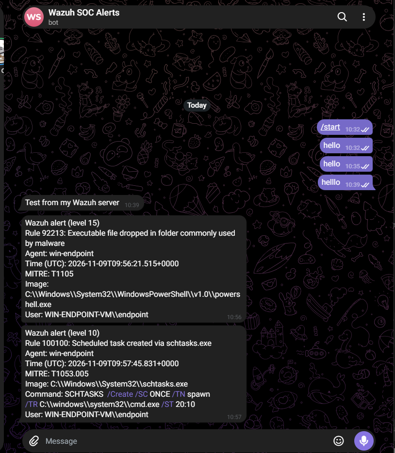
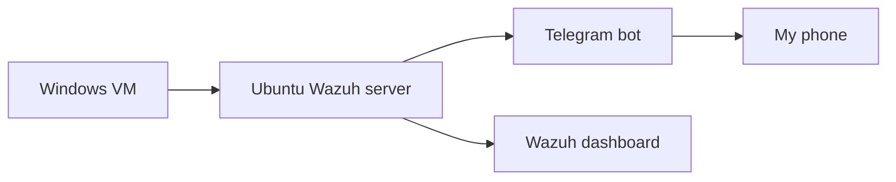

# Wazuh Mini SOC

Home SOC lab built with Wazuh SIEM. Attack simulation, detection engineering, and incident response write-ups.

## Results at a glance

- **Closed a detection gap:** Wazuh missed a scheduled task persistence test (T1053.005), so I wrote custom rule 100100 and it now fires at level 10.
- **Tuned noise without hiding attacks:** a narrow exception (rule 100201) stopped a Windows maintenance alert from buzzing my phone.
- **Caught SSH brute force on Linux:** repeated failed logins from my Windows VM triggered rule 5712 and reached Telegram.

## Why I built this

I'm building toward an entry-level SOC analyst role. I hold the ISC2 CC certification and practice on TryHackMe, and I wanted hands-on experience with the full blue team workflow: collecting logs, detecting attacks, triaging alerts, and tuning detections.

My main focus is alerting and tuning, so the right high-severity alerts reach me quickly without drowning me in noise.

## How it works together

## Lab environment

- Host: Windows laptop, i7-10870H, 32 GB RAM, VirtualBox
- Wazuh 4.14 (all-in-one) on Ubuntu Server
- Windows VM endpoint with Sysmon (SwiftOnSecurity config)
- Atomic Red Team for attack simulation

## What I've built so far

| Area | What I did | Write-up |
|---|---|---|
| Baseline | Recorded normal activity and triaged two false positives | [Phase 3](notes/phase3-baseline.md) |
| Attack simulation | Ran a scheduled task persistence test (T1053.005) and found Wazuh missed it | [Phase 4](notes/phase4-attack-simulation.md) |
| Detection engineering | Wrote custom rule 100100 for scheduled task creation | [Rule file](Detections/100100-schtasks-create.xml) |
| Alerting | Telegram alerts for level 10 and above, using my own integration script | [Phase 6](notes/phase6-telegram-alerting.md) |
| Tuning | Narrow exceptions for known false positives (100200, 100201) | [Phase 7](notes/phase7-tuning.md) |
| Linux detection | Caught SSH brute force from my Windows VM | [Phase 8](notes/phase8-ssh-brute-force.md) |
| Incident report | Investigated and documented the scheduled task attack | [Report 001](notes/incident-report-001-scheduled-task.md) |

## Detections I wrote

| Rule | What it does | Level | MITRE |
|---|---|---|---|
| 100100 | Alerts when schtasks.exe creates a scheduled task | 10 | T1053.005 |
| 100201 | Lowers the known-benign sdbinst.exe maintenance alert (92058) | 3 | |
| 100200 | Lowers PowerShell's own policy-test file alert (92213) | 3 | |

## What I learned

- **Judge the event, not the wrapper.** Fields like manager.name look reassuring but appear on every alert. What matters is inside the event data: what ran, who ran it, from where, and when.
- **A missing alert doesn't mean nothing happened.** My first scheduled task test only produced low-level shell alerts, so I wrote a rule for the gap.
- **Filters can hide alerts.** My SSH alerts weren't missing. My view was filtered to the Windows VM, and the SSH logs belong to the Ubuntu server.
- **Broad exceptions are dangerous.** Ignoring everything in Temp would hide the malware behaviour rule 92213 exists to catch, so each exception matches the program, the path and the command line.
- **Test the config before restarting.** My first Telegram integration stopped the manager from starting because I'd put it outside its section. I now run the config test first.

## Still open

- Rule 100200 hasn't fired yet, so I haven't proven that exception.
- An Edge file also triggers rule 92213, and I haven't confirmed which process writes it.
- Next: VirusTotal enrichment and more attack tests.

## Repo contents

- `notes/`: write-ups for each phase and the incident report
- `Detections/`: custom rules and tuning exceptions
- `scripts/`: the Telegram integration scripts
- `configs/`: example config with placeholders, never real secrets
- `Screenshots/`: evidence for each write-up

## About me

Aspiring SOC analyst based in Lagos, Nigeria. ISC2 Certified in Cybersecurity (CC).
- LinkedIn:www.linkedin.com/in/samuel-lowo-70227822a
