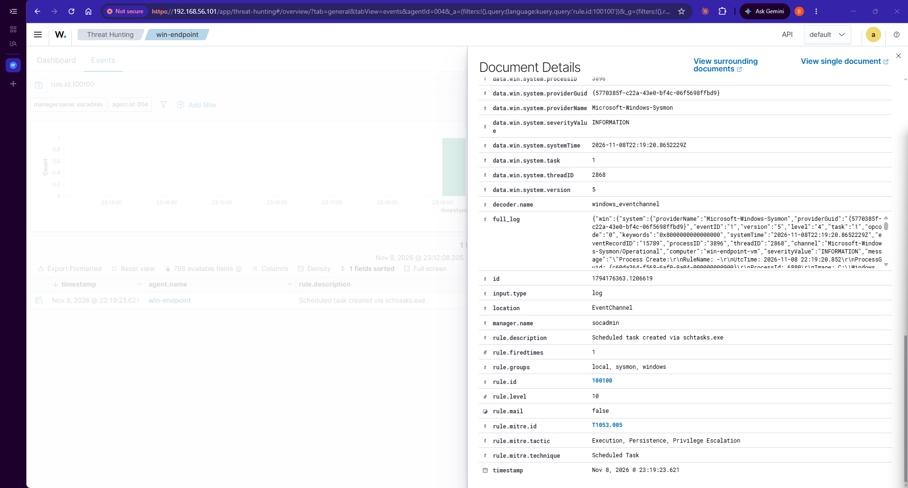
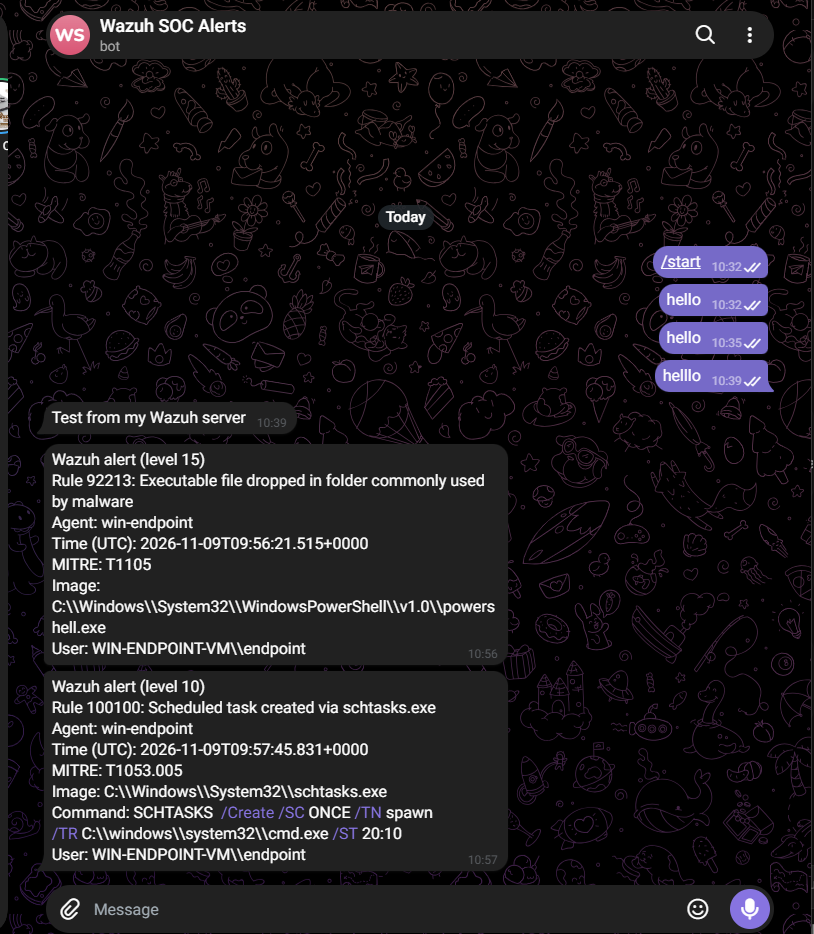

# Incident Report 001: Scheduled task persistence (simulated)

This is a simulated incident. I ran the attack myself with Atomic Red Team so I could practice investigating and documenting one properly.

| | |
|---|---|
| Type | Simulated attack, Atomic Red Team T1053.005 test 2 |
| Host | win-endpoint-vm (agent 004, 192.168.56.102) |
| Account | WIN-ENDPOINT-VM\endpoint |
| Detected by | My custom rule 100100, level 10 |
| MITRE ATT&CK | T1053.005 Scheduled Task (Execution, Persistence, Privilege Escalation) |
| Severity | Medium |
| Status | Closed, task removed |

## Summary
I created a scheduled task called "spawn" on my Windows VM using schtasks.exe, set to run cmd.exe once at 20:10. It's a common persistence technique. The first time I ran it, on 6 November, Wazuh barely noticed, so I wrote a custom rule. On my later runs, rule 100100 fired and the alert reached my phone on Telegram.

## Timeline
| Date and time (UTC +1) | UTC | What happened |
|---|---|---|
| 6 Nov, 14:03 | 13:03 | I ran the test for the first time. Wazuh only flagged PowerShell starting cmd.exe (rule 92004 at level 4, rule 92032 at level 3). Nothing flagged the scheduled task itself. |
| 8 Nov, evening | | I wrote custom rule 100100 for schtasks.exe with /create. |
| 8 Nov, 23:19 | 22:19 | I ran the test again. Rule 100100 fired at level 10. |
| 9 Nov, 10:57 | 09:57 | I ran it once more. Rule 100100 reached Telegram with the full command line. |
| 9 Nov, after that run | | I ran the Atomic cleanup command and checked with schtasks /query that the task was gone. |

## What I saw in the alert
| Question | Answer |
|---|---|
| What ran? | schtasks.exe from C:\Windows\System32 |
| What started it? | cmd.exe, started by powershell.exe |
| How? | SCHTASKS /Create /SC ONCE /TN spawn /TR C:\windows\system32\cmd.exe /ST 20:10 |
| Where from? | System32, a genuine Microsoft binary |
| Who and when? | My own account, while I was running the test |

On their own, none of these is a smoking gun. Together they look like persistence: PowerShell starts a command shell, which creates a one-time task called "spawn" that runs another command shell.

## Impact
- Confidentiality: nothing was read or sent out.
- Integrity: one scheduled task was added to the system, then removed.
- Availability: no effect.

## Response
I removed the task with the Atomic Red Team cleanup command and confirmed with schtasks /query that it no longer exists. The task from my first run stayed on the VM until I cleaned it up on 8 November, so it may have run once at its scheduled time. It only starts cmd.exe, so there was no harm, but I didn't check whether it ran.

## Root cause
I ran the test myself.

## What went wrong in detection
Before rule 100100 existed, Wazuh only raised low-level alerts about the shell chain. At my Telegram threshold of 10, I would have heard nothing about the scheduled task.

## Other alerts at the time
Rule 92213 (level 15) also reached my phone around the same time. I haven't checked which file triggered it on that run, so I'm not counting it as part of this incident.

## What I'd improve
- I'd add the user and parent process to the Telegram message, so I don't have to open the dashboard for every alert.
