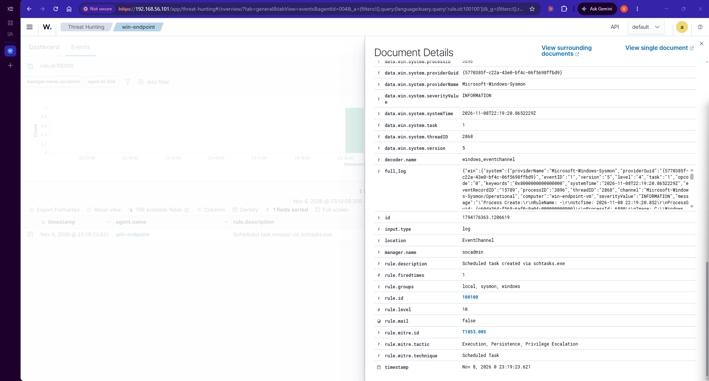

# Phase 4: Attacking my own lab

I use Atomic Red Team on the Windows VM, never on my laptop. I take a snapshot first and clean up after each test.

## Test 1: Scheduled task creation (T1053.005, test 2)

I ran the test, then searched Wazuh for anything tagged T1053.005. Nothing came back.

What Wazuh did catch was a PowerShell process starting cmd.exe (rules 92004 and 92032, levels 4 and 3). The command line showed cmd.exe /c SCHTASKS /Create /SC ONCE /TN spawn, so the scheduled task was created, but no rule noticed the task itself. That is a detection gap.

## What I did about it
I wrote custom rule 100100. It fires when schtasks.exe runs with /create, and it's mapped to T1053.005. I tested it with wazuh-analysisd -t, restarted the manager, and ran the same test again.

| | Before | After |
|---|---|---|
| Alert | Shell chain only, level 3-4 | Rule 100100, level 10 |
| MITRE tag | None | T1053.005 (Scheduled Task) |

## Things that tripped me up
- Atomic Red Team failed to load in a new PowerShell window because script execution was blocked. Running Set-ExecutionPolicy Bypass -Scope Process -Force fixes it, but only for that window.
- My first search for the test found nothing because I hadn't actually run it yet. I had only listed the tests.

## Still undecided
Rule 100100 is level 10, but I planned to send only level 12 and above to Telegram. Should a new scheduled task wake me up? I'll decide once I see how often it fires in normal use.
