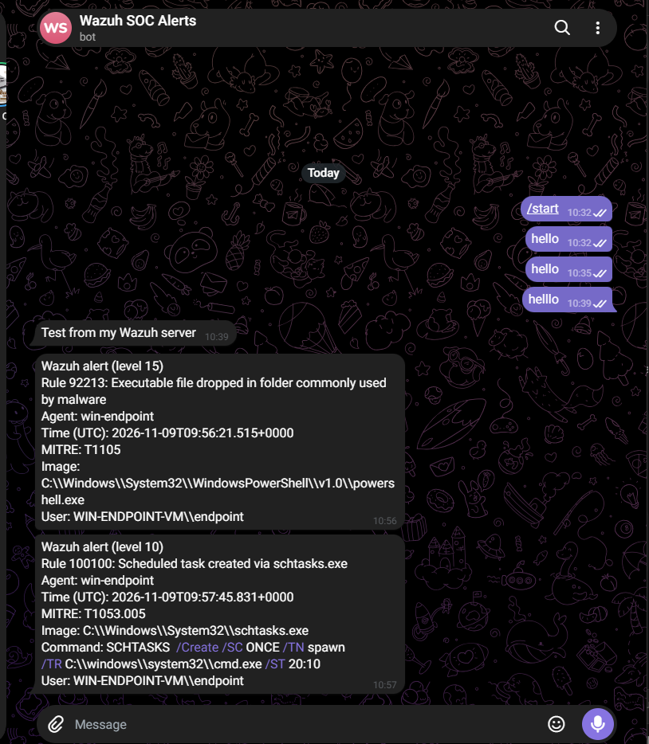

# Phase 6: Telegram alerting

My main aim for this lab is getting the right alerts to me without drowning me in noise. This phase is where that starts.

## What I built
I made a Telegram bot with BotFather and tested it from my Wazuh server with a plain curl message before touching Wazuh itself. Wazuh has no built-in Telegram integration, so I wrote a small custom one: a wrapper script plus a Python script that reads the alert and sends a short summary (rule, level, agent, MITRE ID, command line and user).

## The threshold
I set it to level 10, so my custom rule 100100 (scheduled task creation) reaches my phone.

## What actually reached my phone
When I re-ran the scheduled task test, two alerts arrived:
- Rule 100100, level 10: my custom detection, working as intended.
- Rule 92213, level 15: the PowerShell policy-test file I had already triaged as a false positive.

The second one is the problem I'm trying to solve. A level 15 alert that fires whenever PowerShell starts would make me ignore my phone. Rule 92058 (level 12) can do the same.

## What went wrong
My first attempt stopped the Wazuh manager from starting with "Invalid element in the configuration: 'integration'". I had used the integration block after the last closing ossec_config tag, so it sat outside any section. Wrapping it in its own ossec_config block fixed it. I now run wazuh-analysisd -t before restarting.

## Keeping secrets out of the repo
The real bot token and chat ID live only in ossec.conf on the server. The repo has a config example with placeholders.

## Next
Add narrow exceptions for 92213 and 92058, so only alerts worth reading reach my phone.
