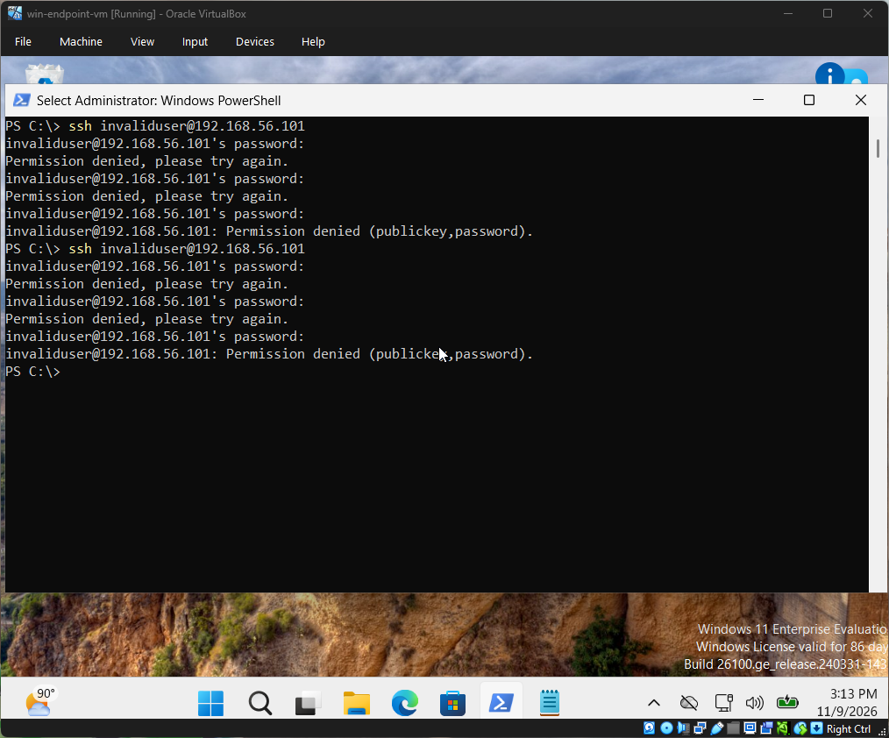
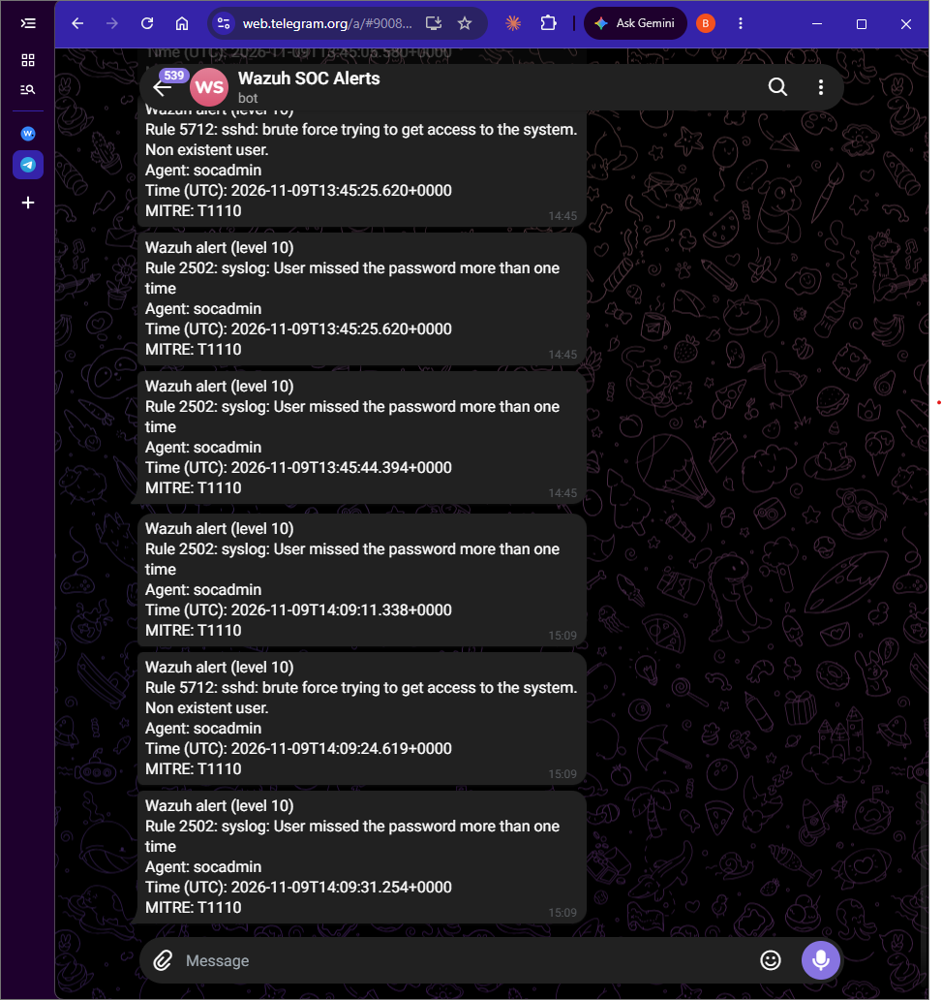
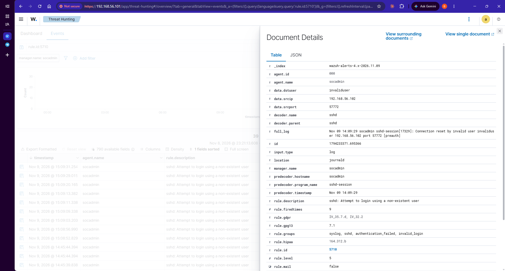

# Phase 8: SSH brute force from my Windows VM

So far my attacks had all been on the Windows side. Here I wanted to see Wazuh catch something against the Linux server.

## What I did
From the Windows VM I ran ssh invaliduser@192.168.56.101 and typed a wrong password three times. I repeated it several times. The user invaliduser doesn't exist on the Ubuntu server.

## What reached my phone
Two rules, both at level 10 and tagged MITRE T1110:
- Rule 5712: sshd brute force trying to get access to the system, non existent user
- Rule 2502: syslog, user missed the password more than one time

The agent on both was socadmin, which is the Wazuh server itself, not the Windows VM.

## Why I couldn't find them at first
My Wazuh view was filtered to agent 004, the Windows VM. SSH logs live on the Ubuntu server, which Wazuh treats as its own agent, so they didn't show up. Once I removed the filter they were there.

## What I found
Wazuh logged 39 alerts for rule 5710 and 11 for rule 5503, both at level 5, and 3 alerts for rule 5712 at level 10. The level 5 ones stay below my Telegram threshold, and 5712 fires once the failures repeat, which is why only a few messages reached my phone. These counts cover the whole alert file for the day, so they aren't the number of attempts I made.The alerts recorded the source IP (192.168.56.102, my Windows VM) and the username I tried, so I could trace the attack back to the machine it came from.

## What I noticed
At my level 10 threshold, these rules reach me, and they're alerts I actually want, unlike 92213 and 92058. But one round of failed logins sent several messages to my phone, so I get more than one buzz for the same activity.

